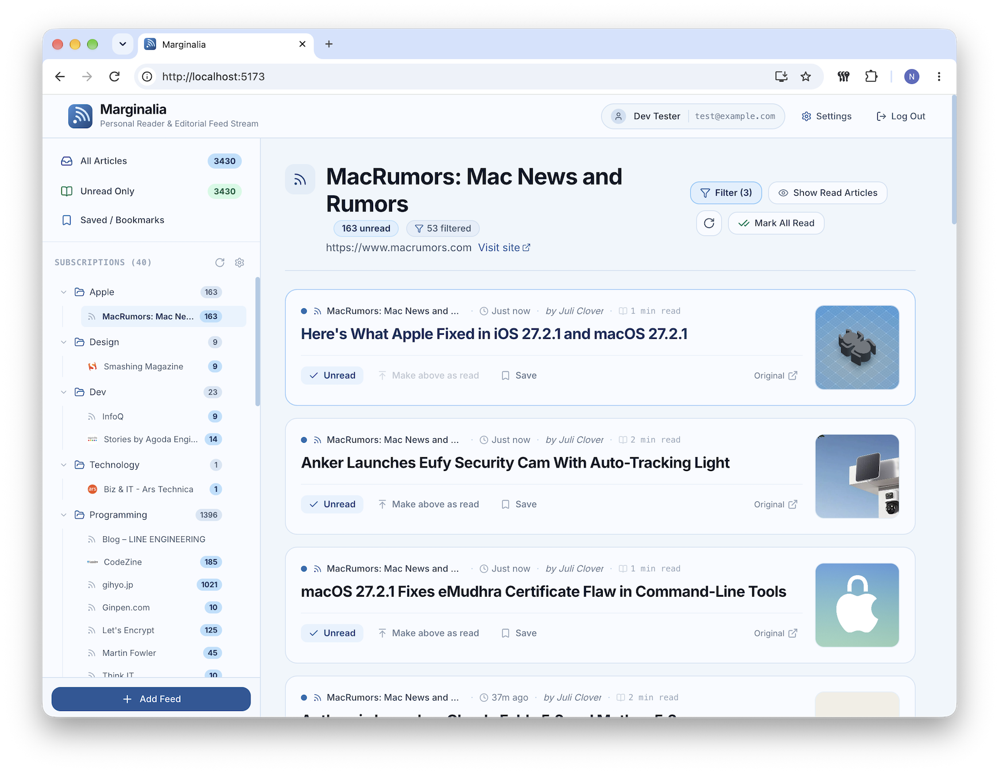

# Marginalia

[](https://github.com/nobudev7/marginalia/releases)
[](https://github.com/nobudev7/marginalia/actions/workflows/ci.yml)
[](LICENSE)
[](https://openjdk.org/)
[](https://spring.io/projects/spring-boot)
[](https://react.dev/)

A refined, private RSS reader designed for focused, distraction-free reading across desktop and mobile.



---

## Key Features

### 📖 Elegant, Focused Reading Experience
- **Distraction-Free Reading Drawer**: Read articles in a clean, typography-optimized modal drawer with adjustable font sizes and comfortable line spacing.
- **Visual Card & Compact Streams**: Switch between rich visual summary cards (with high-res thumbnails extracted from RSS enclosures or Open Graph/Twitter meta tags) and a compact list view for high-throughput scanning.
- **Fast Navigation**: Effortlessly traverse your feeds with keyboard shortcuts (`J`/`K` navigation, `O` open, `M` toggle read, `S` star/bookmark) or intuitive **Next Feed** / **Next Folder** actions.
- **Mark Above as Read**: Quickly triage busy feeds by marking everything above your current scroll position as read with a single click.

### 📁 Effortless Organization & Curation
- **Drag-and-Drop Structure**: Freely reorganize category folders and individual feed subscriptions with fluid, touch-friendly drag-and-drop.
- **Smart Title Exclusion Filters**: Automatically filter out noise, unwanted topics, or spoilers on a per-feed basis using customizable keyword/phrase exclusion rules.
- **Live Unread Badges**: Real-time counters keep track of what's new across all categories without intrusive notifications.
- **One-Click OPML Import & Export**: Effortlessly bring your existing subscriptions from Feedly, Inoreader, or NetNewsWire, or export your full library anytime.

### 📱 Full-Featured Progressive Web App (PWA)
- **Installable Everywhere**: Install Marginalia directly to your iPhone, iPad, Android, or macOS/Windows desktop as a native standalone app shell.
- **Mobile-Optimized Touch Gestures**: Mobile long-press contextual menus, bottom navigation tabs, and dedicated gesture handling ensure a fluid mobile-first experience.
- **Offline Resilience**: Built-in service worker caching keeps the application responsive and resilient even under intermittent connectivity.

### 🔒 Privacy-First & Zero Passwords
- **Single-User Privacy**: Your reading habits, article bookmarks, and feed subscriptions belong exclusively to you—no tracking, no telemetry, no analytics.
- **Secure OAuth2 Authentication**: Sign in securely using your existing Google or GitHub account, protected by a strict database-backed email whitelist. No passwords to remember or leak.
- **Persistent Sessions**: Enjoy long-lived, secure 60–90 day authenticated sessions across all your devices.

---

## Technical Architecture & Craftsmanship

Marginalia was engineered with production reliability, high efficiency, and clean abstractions from day one:

```text
┌─────────────────────────────────────────────────────────────────────────────┐
│                              Client Layer                                   │
│            React 19 SPA + PWA Service Worker + Tailwind CSS                 │
└──────────────────────────────────────┬──────────────────────────────────────┘
                                       │ HTTPS / HTTP/3
┌──────────────────────────────────────▼──────────────────────────────────────┐
│                  Edge Reverse Proxy & TLS (Caddy v2)                         │
│       Automated Let's Encrypt ACME Certificates + Security Headers          │
└──────────────────────────────────────┬──────────────────────────────────────┘
                                       │ Reverse Proxy (:8080)
┌──────────────────────────────────────▼──────────────────────────────────────┐
│                    Application Backend (Spring Boot 4.1)                    │
│   • Java 25 LTS with Virtual Threads for concurrent feed crawling           │
│   • ROME Tools parser with auto-channel title detection & HTML normalization│
│   • Conditional HTTP fetching (ETag / If-Modified-Since) for low bandwidth  │
│   • Spring Security OAuth2 (Google/GitHub) + Email Whitelist Enforcement    │
└──────────────────────────────────────┬──────────────────────────────────────┘
                                       │ JDBC Connection Pool (HikariCP)
┌──────────────────────────────────────▼──────────────────────────────────────┐
│                       Data Storage (MySQL 8.4 LTS)                          │
│     Flyway automated schema migrations • ACID relational consistency        │
└─────────────────────────────────────────────────────────────────────────────┘
```

### ⚡ Performance & Resource Efficiency
- **Java 25 Virtual Threads**: Ingests and parses dozens of external RSS/Atom feeds concurrently using lightweight virtual threads without blocking operating system thread resources.
- **Smart Bandwidth Conservation**: The crawler engine automatically respects HTTP `304 Not Modified`, `ETag`, and `If-Modified-Since` cache headers, minimizing unnecessary network traffic and host CPU cycles.
- **Fail-Closed Security**: Configured to fail safely by default—mandating TLS database connections, secure HTTPS cookie attributes, and sanitized user input across all endpoints.

### ☁️ Cloud Portability & Modular Infrastructure (Terraform)
Marginalia features a **modular, multi-provider Infrastructure as Code (IaC)** design under [`deploy/terraform/`](deploy/terraform/):
- **Zero-Cost Deployment on Oracle Cloud (OCI)**: Run compute for `$0.00/mo` on OCI's Always Free Ampere Altra ARM64 architecture (`VM.Standard.A1.Flex`, 2 OCPUs, 12 GB RAM) with dedicated VCN and Reserved Static Public IP.
- **AWS Lightsail Compatible**: Alternative turn-key compute stack on AWS Lightsail (~$7/mo).
- **Decoupled DNS & Cross-Cloud Disaster Recovery**: Independent Route 53 DNS routing and automated daily database snapshots synced to encrypted AWS S3 buckets (`backup-s3/`). If compute ever moves or fails, your data remains completely safe.

---

## Getting Started

### Local Development (Quickstart)
Marginalia includes a dedicated `dev` profile that enables instantaneous local testing without needing OAuth2 cloud credentials:

1. **Clone the repository:**
   ```bash
   git clone https://github.com/nobudev7/marginalia.git
   cd marginalia
   ```

2. **Start the local database:**
   ```bash
   docker compose -f compose.dev.yaml up -d
   ```

3. **Start the backend:**
   ```bash
   cd backend
   ./mvnw spring-boot:run -Dspring-boot.run.profiles=dev
   ```

4. **Start the frontend:**
   ```bash
   cd frontend
   npm install
   npm run dev
   ```

5. Open [http://localhost:5173](http://localhost:5173) and click **"Sign in as Dev User"** to jump straight into the reader.

*For full details on development profiles and test accounts, see the [Local Development Guide](docs/local-development-guide.md).*

---

## Production Deployment

Marginalia is packaged for one-command containerized production deployment using Docker Compose and Caddy:

1. **Provision Cloud Infrastructure (Terraform)**:
   Follow the guide in [`deploy/terraform/README.md`](deploy/terraform/README.md) to launch on **Oracle Cloud (Always Free ARM)** or **AWS Lightsail**.
2. **Launch Application Containers**:
   ```bash
   cd /opt/marginalia/deploy
   cp .env.example .env && chmod 600 .env
   # Populate your domain and OAuth2 credentials
   docker compose up -d --build
   ```
3. **Automate Daily Backups**:
   ```bash
   sudo systemctl enable --now marginalia-backup.timer
   ```

*For complete operational procedures, SSL automation, and DNS setup, see the [Production Deployment Guide](docs/deployment-guide.md).*

---

## Documentation & Guides

- [Production Deployment Guide](docs/deployment-guide.md) — Comprehensive guide for OCI, AWS Lightsail, Terraform, and Caddy TLS.
- [Production Orchestration Guide](docs/production-orchestration-verification.md) — Docker Compose architecture, MySQL memory tuning, and cascading healthchecks.
- [Backup & Disaster Recovery Guide](docs/backup-restore-verification.md) — Hot backups, S3 synchronization, and restore testing.
- [OAuth2 Setup Guide](docs/oauth2-setup-guide.md) — Google and GitHub OAuth2 configuration walkthrough.
- [Email Whitelist Administration Guide](docs/whitelist-admin-guide.md) — Access control, administration, and safety rules.
- [Changelog](CHANGELOG.md) — Release notes and version history.
- [Development Log](docs/notes/dev-log.md) — Architectural decisions, engineering log, and verification records.

---

## License

This project is open source and licensed under the [MIT License](LICENSE).
